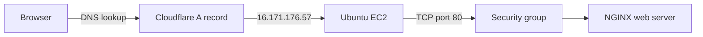
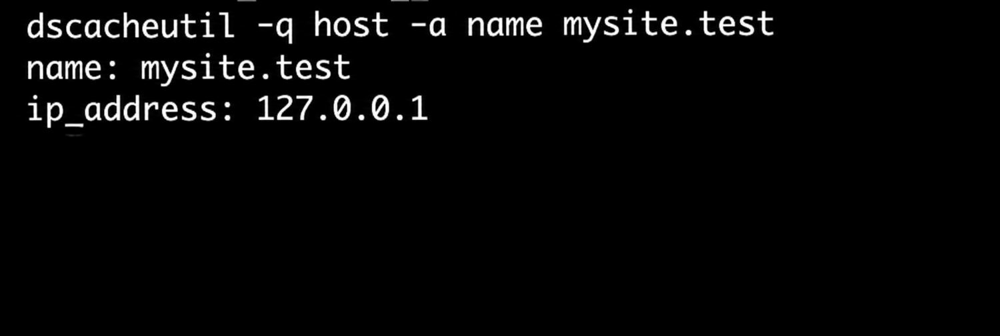
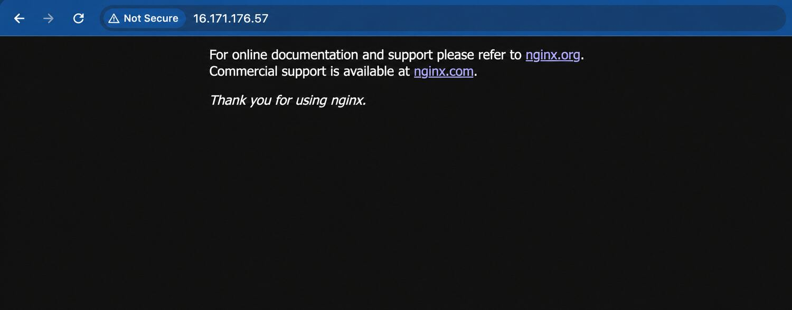
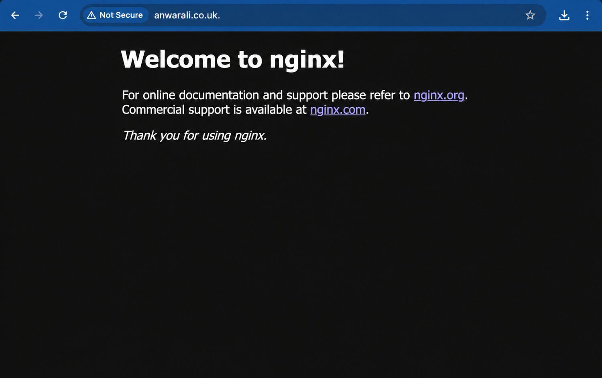

# Networking Fundamentals: DNS, EC2, and NGINX

**Status:** Completed 25 November 2026  
**Live site:** [http://anwarali.co.uk](http://anwarali.co.uk)

This project applies networking fundamentals by resolving a domain to an AWS EC2 server and serving the NGINX welcome page.



## What I built

1. Registered `anwarali.co.uk` with Cloudflare.
2. Launched an Ubuntu EC2 instance with a public IPv4 address.
3. Installed and started NGINX.
4. Added a Cloudflare A record for the root domain (`@`) pointing to the EC2 public IPv4 address. DNS-only mode made it straightforward to verify the returned address.
5. Checked DNS with `dig` and loaded the NGINX page through the domain.

The site is currently served over HTTP. HTTPS is a possible next improvement.

### Commands used

Install and start NGINX on Ubuntu:

```bash
sudo apt update
sudo apt install -y nginx
sudo systemctl enable --now nginx
```

Check the public DNS answer:

```bash
dig +short anwarali.co.uk
```

The result was `16.171.176.57`, the instance's public IPv4 address.

## Networking concepts learned

### DNS records and resolution

DNS translates a domain name into records that computers can use. An **A record** maps a name to an IPv4 address; an **NS record** identifies the name servers responsible for a DNS zone. `dig` and `nslookup` query DNS. A recursive resolver can return cached answers, which expire according to their TTL.

The public A record for `anwarali.co.uk` directs visitors to the EC2 server. By contrast, `/etc/hosts` is a local file that affects name lookup on one computer. I mapped a practice name to loopback and checked it on macOS:

```text
127.0.0.1 mysite.test
```

```bash
dscacheutil -q host -a name mysite.test
```

`127.0.0.1` is loopback, meaning “this computer.” `dig` and `nslookup` query DNS directly, so they are not the right way to verify a local hosts-file entry.

### IPv4, binary, and subnetting

An IPv4 address has four 8-bit octets. For example:

```text
192.168.1.1 = 11000000.10101000.00000001.00000001
```

For `192.168.1.0/26`, the mask is `255.255.255.192`; the network address is `192.168.1.0`, the broadcast address is `192.168.1.63`, and usable host addresses range from `192.168.1.1` to `192.168.1.62` (62 addresses).

Public IPv4 addresses are reachable over the internet when routing and firewall rules permit. Private IPv4 addresses are used inside networks and are not directly routed across the public internet. A public hostname must point to the server's public address, not a private address such as one in `10.0.0.0/8`, `172.16.0.0/12`, or `192.168.0.0/16`.

### Routing and troubleshooting

`ping` checks whether a host responds; `traceroute` shows intermediate network hops; `dig` and `nslookup` check DNS. These tools help separate name-resolution problems from connectivity or routing problems. Some hosts and networks do not answer ping or traceroute probes, so missing replies are not by themselves proof of an outage.

### Ports, TCP, UDP, and security groups

Ports identify network services on a host. This project serves HTTP through NGINX on TCP port 80 and uses SSH on TCP port 22 for administration. DNS commonly uses UDP port 53 and can also use TCP. TCP establishes a connection and tracks delivery; UDP sends datagrams without the same delivery guarantees.

An EC2 security group acts as a virtual firewall. A sensible web-server setup allows inbound TCP 80 from visitors and restricts SSH (TCP 22) to a trusted source IP. Never publish an SSH private key or AWS credentials.

### NAT and the OSI model

NAT lets devices using private addresses communicate through public addressing, commonly through a home router. Cloud servers also distinguish public and private addressing; the public address is what internet visitors use, while private addressing is used within the cloud network.

The OSI model gives a layered way to reason about a web request: **Application** (HTTP), **Presentation** (data format and encryption such as TLS), **Session** (conversation management), **Transport** (TCP/UDP), **Network** (IP and routing), **Data link** (Wi-Fi/Ethernet frames), and **Physical** (radio, copper, or fibre signals).

## Evidence

The screenshots are cropped to show the relevant command or page while omitting unrelated terminal tabs and prompts.

### Local hosts-file lookup



### NGINX responds on the EC2 public IP



### DNS resolves the domain to the EC2 public IP


### NGINX responds through the domain



## Notes

- `anwarali.co.uk` currently points to the EC2 public IPv4 address shown above.
- If the instance's public IPv4 address changes, update the A record.
- Keep an eye on AWS charges and shut down resources that are no longer needed.
